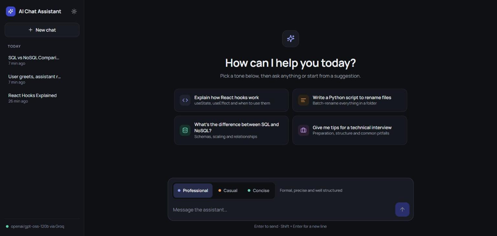
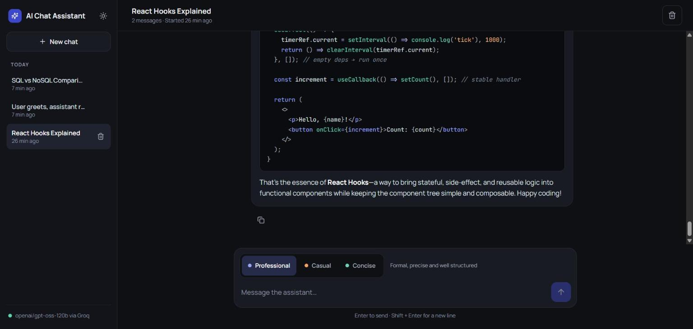
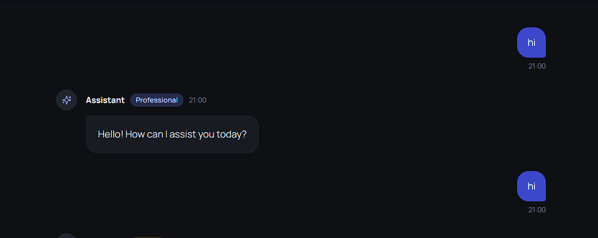
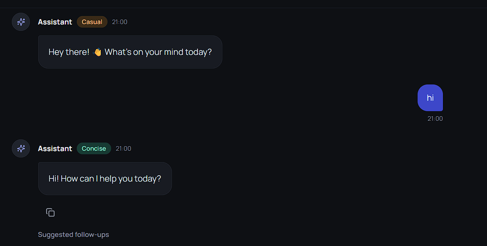
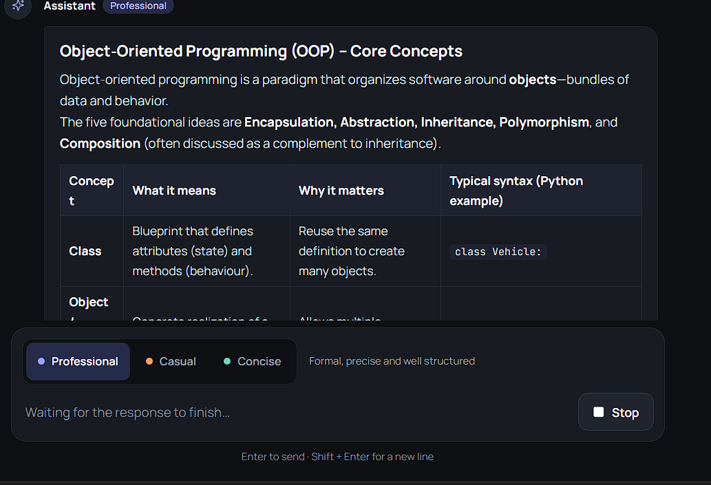
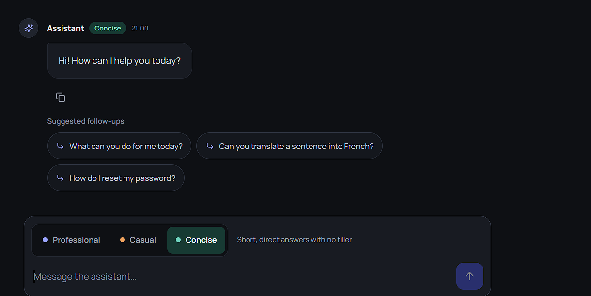
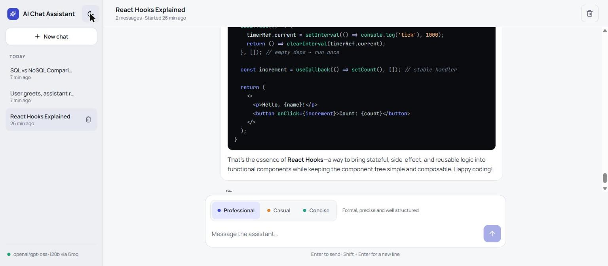
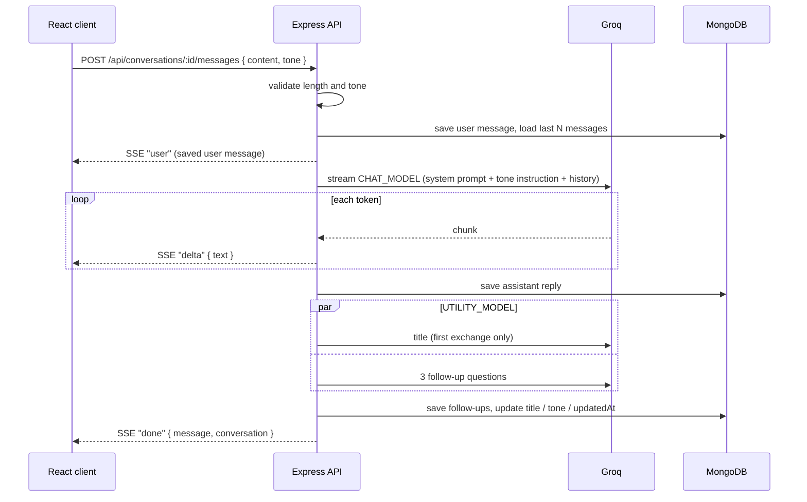

# AI Chat Assistant

A full-stack AI chat app: a React client streams replies from a Groq-hosted LLM through an Express API, with every conversation saved in MongoDB.

## Screenshots

| | |
|---|---|
|  |  |
| **Empty state:** starter prompts and the tone picker | **History sidebar:** conversations grouped by day, with the open one in the header |
|  |  |
| **Chat bubbles:** user and assistant messages with timestamps | **Tone toggle:** each reply is labelled with the tone it was written in |
|  |  |
| **Streaming:** the reply appears live; Stop ends it early | **Follow-ups:** suggested next questions under the latest reply |


**Light theme:** the whole UI also comes in a light version (code blocks stay dark)

## Features

### Core features

- **Chat bubbles:** user messages on the right; assistant replies on the left with an avatar, tone badge and time. Replies render Markdown (headings, lists, tables), and code blocks get syntax highlighting and a Copy button.
- **Streaming responses:** replies arrive token by token over Server-Sent Events. **Stop** ends a reply early, and the partial answer is saved, marked "Response stopped".
- **History sidebar:** conversations are listed newest first, grouped into *Today* / *Earlier*, with relative times ("7 min ago"). Click a conversation to reopen it. Click the title in the header to rename it. Delete it from the sidebar or the header (asks for confirmation).
- **LLM via Groq:** calls Groq's Chat Completions API (OpenAI-compatible format) through the official `groq-sdk`. Models are set in `.env`.
- **MongoDB persistence:** conversations and messages are stored with Mongoose and survive restarts.
- **Tone toggle:** Professional, Casual or Concise. The client sends only the tone's id. The server checks it and adds that tone's instruction to the system prompt. The chosen tone is saved per message and per conversation, and reopening a conversation selects its last tone again.

### Additional features

- **AI-generated titles:** after the first exchange, a smaller model names the conversation ("React Hooks Explained"). *Why:* the sidebar stays scannable without users having to name every chat.
- **AI-suggested follow-up questions:** after each completed reply, up to three short follow-up questions appear as clickable chips. *Why:* it shows users where to go next and turns a dead-end answer into a conversation.

### Also included

- Light and dark themes. The app follows the system setting until you pick one, then remembers your choice.
- Copy button for the latest reply, starter prompts on the empty screen, and a typing indicator.
- A distinct "Rate limit reached" alert when Groq returns HTTP 429.
- If one message fails to render, it falls back to plain text instead of crashing the app.
- Responsive layout: below 768px the sidebar becomes a slide-out drawer.

## Tech stack

| Layer | Technology |
|---|---|
| Client | React 18, Vite 5, react-markdown + remark-gfm, react-syntax-highlighter (Prism, languages loaded on demand), lucide-react |
| Server | Node.js, Express 4, Mongoose 8, groq-sdk, dotenv, cors |
| Database | MongoDB (MongoDB Atlas or a local instance) |
| LLM | Groq: `openai/gpt-oss-120b` for chat, `openai/gpt-oss-20b` for titles and follow-ups (both configurable) |
| Tooling | `concurrently` runs client and server with one command |

## Quick start

**Prerequisites**

- Node.js 18.11 or newer (the server uses `node --watch`)
- A MongoDB connection string (free MongoDB Atlas cluster or local MongoDB)
- A Groq API key (free at [console.groq.com/keys](https://console.groq.com/keys))

**Steps**

```bash
git clone https://github.com/kedarnath745/Quantify_vibe_coding.git
cd Quantify_vibe_coding
npm run install:all
cp server/.env.example server/.env   # then fill in MONGODB_URI and GROQ_API_KEY
npm run dev
```

Open **http://localhost:5173**. The Vite dev server proxies `/api` to the Express server on port 5000.

If a required variable is missing, the server names it and exits:

```
Missing required environment variables in server/.env:
  - GROQ_API_KEY: Groq API key (https://console.groq.com/keys)
```

### Environment variables (`server/.env`)

| Variable | Required | Description |
|---|---|---|
| `MONGODB_URI` | yes | MongoDB connection string |
| `GROQ_API_KEY` | yes | Groq API key |
| `CHAT_MODEL` | yes | Groq model for chat replies |
| `UTILITY_MODEL` | yes | Groq model for titles and follow-up questions |
| `PORT` | no | API port (default `5000`) |
| `CLIENT_ORIGIN` | no | Origin allowed by CORS. If empty, cross-origin requests are refused; not needed with the dev proxy |
| `MAX_CONTEXT_MESSAGES` | no | Recent messages sent to the model as context (default `20`) |
| `MAX_MESSAGE_LENGTH` | no | Maximum characters per user message (default `4000`) |
| `DNS_SERVERS` | no | Comma-separated DNS servers for Node, e.g. `8.8.8.8,1.1.1.1`. Only needed if `mongodb+srv://` fails with `querySrv ECONNREFUSED` |

## Architecture

### Request flow



1. On the first message of a new chat, the client creates the conversation (`POST /api/conversations`) and then posts the message with the selected tone.
2. The server validates the message, saves it and loads the last `MAX_CONTEXT_MESSAGES` messages as context.
3. The system prompt is the base assistant prompt plus the tone's instruction from `server/src/prompts/tones.js`, and it's streamed from `CHAT_MODEL`.
4. Each chunk is forwarded to the client as an SSE `delta` event. The client reads the stream with `fetch` because `EventSource` can't send a POST body.
5. When the stream ends, the reply is saved. For a completed reply, `UTILITY_MODEL` generates the title (only while the conversation is still "New chat") and the follow-up questions in parallel.
6. A final `done` event carries the saved reply (with `followUps`) and the updated conversation, including its sidebar labels.

**Stop / disconnect:** the client aborts the request. The server notices the closed connection, aborts the Groq stream and saves the partial reply with `incomplete: true`. No title or follow-ups are generated for it.

### Folder structure

```
├── package.json              install:all and dev scripts (concurrently)
├── docs/screenshots/         README images
├── client/                   React + Vite
│   ├── index.html            fonts and pre-render theme script
│   ├── vite.config.js        dev server on 5173, /api proxy to 5000
│   └── src/
│       ├── App.jsx           app state: conversations, streaming, tone, errors
│       ├── api.js            REST helpers and SSE stream reader
│       ├── theme.js          light/dark theme hook
│       ├── styles/global.css design tokens for both themes, layout, components
│       └── components/
│           ├── Sidebar.jsx        brand, theme switch, grouped history, model label
│           ├── ChatHeader.jsx     title (click to rename), message count, delete
│           ├── ChatView.jsx       messages, empty state, follow-up chips
│           ├── Composer.jsx       input, tone toggle, send / stop
│           ├── ToneToggle.jsx     segmented tone control
│           ├── Markdown.jsx       Markdown and code blocks
│           ├── codeTheme.js       syntax highlighting colours
│           └── ErrorBoundary.jsx  plain-text fallback for a failed render
└── server/                   Express API
    ├── .env.example
    └── src/
        ├── server.js         checks env, connects to MongoDB, starts the API
        ├── app.js            middleware and small endpoints (health, config, meta, tones)
        ├── config/env.js     required-variable check
        ├── config/db.js      MongoDB connection (optional DNS override)
        ├── models/           Conversation and Message schemas
        ├── prompts/tones.js  tone definitions and system-prompt instructions
        ├── routes/conversations.js  CRUD and streaming endpoint
        ├── services/llm.js   Groq streaming chat, titles, follow-ups
        ├── utils/time.js     "Today/Earlier" groups and relative times
        └── middleware/errors.js     async wrapper and JSON error responses
```

## API

### Endpoints

| Method | Path | Description |
|---|---|---|
| `GET` | `/api/health` | `{ status, db }`: server and MongoDB status |
| `GET` | `/api/config` | `{ maxMessageLength }` |
| `GET` | `/api/meta` | `{ modelLabel }`, e.g. `openai/gpt-oss-120b via Groq` |
| `GET` | `/api/tones` | `[{ id, label, description }]` |
| `GET` | `/api/conversations` | Up to 200 conversations, newest first, each with `messageCount`, `group`, `relativeTime` and `startedTime` |
| `POST` | `/api/conversations` | Create an empty conversation (`201`) |
| `GET` | `/api/conversations/:id` | `{ conversation, messages, messageCount }` |
| `PATCH` | `/api/conversations/:id` | Rename: `{ "title": "..." }` (1–100 characters) |
| `DELETE` | `/api/conversations/:id` | Delete the conversation and its messages (`204`) |
| `POST` | `/api/conversations/:id/messages` | Send `{ "content": "...", "tone": "casual" }` and receive an SSE stream. `tone` is optional (default `professional`) |

Errors are JSON `{ "error": "..." }`: `400` for an empty or too-long message, unknown tone, invalid id or bad JSON; `404` for a missing conversation; `500` otherwise.

### SSE events (`POST /api/conversations/:id/messages`)

| Event | Data | When |
|---|---|---|
| `user` | the saved user message | first, once the message is stored |
| `delta` | `{ text }` | for every chunk of the reply |
| `error` | `{ error, status? }` | generation failed (`status: 429` when Groq rate-limits) |
| `done` | `{ message, conversation }` | last; `message` is the saved reply with `followUps` (or `null` if nothing was generated), `conversation` has the new title and labels |

## Design decisions

**Business logic lives on the server.** The client sends only the message text and a tone id. Tone instructions, validation (length, tone, ids), context selection, titles, follow-ups and the sidebar's *Today/Earlier* and "7 min ago" labels are all produced by the API. This keeps the API key and prompts out of the browser. It also stops a client from injecting its own system prompt, and keeps the React code focused on rendering.

**Messages are stored in their own collection, not embedded in the conversation document.** Each `Message` references its `Conversation` and is indexed on `{ conversation, createdAt }`. That means:
- The sidebar list reads small conversation documents instead of whole chat histories.
- Loading context is an indexed query for the last N messages.
- Adding follow-ups or saving a partial reply touches one message, not the whole conversation.
- A long chat can't hit MongoDB's 16 MB document limit.

The trade-off is an extra `deleteMany` when deleting a conversation and an aggregation to count messages for the sidebar.

**A smaller model handles titles and follow-ups.** These are short, low-stakes outputs, so `UTILITY_MODEL` (`gpt-oss-20b`) is faster and cheaper than the chat model. Both requests start only after the main reply has finished streaming, so they never slow the reply text. They run in parallel, and a failure in either is logged and skipped instead of failing the message.

**Switching from Groq to OpenAI.** Model names are set in `.env`, so switching between Groq models needs no code changes. Switching to another provider needs a small code change, because the server uses `groq-sdk` and reads `GROQ_API_KEY`:
1. In `server/src/services/llm.js`, replace `groq-sdk` with the `openai` package: `new OpenAI({ apiKey, baseURL })`. The `chat.completions.create` calls and streaming loop stay the same, because Groq's API follows the OpenAI format.
2. Rename the key variable, and update `server/src/config/env.js` and `.env.example` to match.
3. Set `CHAT_MODEL` and `UTILITY_MODEL` to that provider's models, and change the `via Groq` label in `server/src/app.js`.

## Known limitations

- No authentication: everyone who can reach the server shares one conversation list.
- No automated test suite.
- Relative times and day groups use the server's timezone.
- The sidebar shows the 200 most recent conversations.
